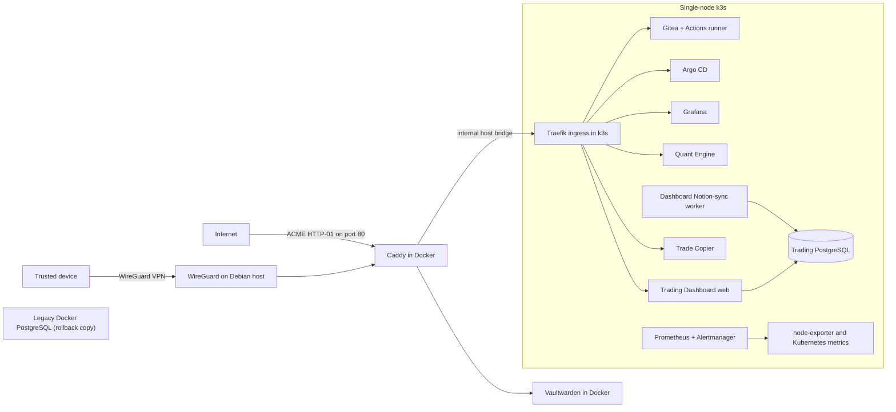

# Platform architecture

The platform runs on one Debian 13 server. k3s runs the Kubernetes workloads; WireGuard and Caddy stay on the host so the VPN and TLS entry point are not inside the cluster. Sensitive addresses, credentials, VPN configuration and production manifests are omitted.

## Overview

## Components and boundaries

| Location | Services |
|---|---|
| Debian host | WireGuard |
| Docker outside k3s | Caddy, Vaultwarden, retained legacy PostgreSQL rollback container |
| k3s platform | Gitea, Gitea Actions runner, Argo CD, Traefik |
| k3s monitoring | Prometheus, Grafana, Alertmanager, node-exporter, kube-state-metrics |
| k3s applications | Quant Engine, Trading Dashboard web/worker, Trade Copier |
| k3s data | Trading PostgreSQL and local-path volumes |

The old Docker trading web and worker containers are stopped. The legacy Docker database is not the active dashboard database. Vaultwarden is not managed by Argo CD.

## Cluster and storage

One Debian 13 host runs one k3s server node with the embedded datastore and containerd. The built-in k3s Traefik and ServiceLB are disabled; a separate Traefik deployment is managed in k3s. Persistent volumes use the local-path provisioner on the server disk. There is no second node, replicated storage or Kubernetes high availability.

The Dashboard web service and worker use PostgreSQL. The worker syncs the configured Notion data source. The Quant Engine and Trade Copier also keep application state on persistent volumes.

## Source of truth

Argo CD’s `trading-services` application watches the `kubernetes/apps` path in a private Gitea infrastructure repository. This public GitHub documentation repository is a separate copy and does not automatically update the private repository.
