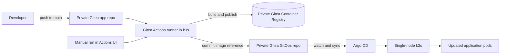

# CI/CD and GitOps deployment flow

Gitea Actions builds the application image. Argo CD deploys the version recorded in the private GitOps repository.

## Sequence

1. A change is pushed to `main`, or an authorized user manually dispatches the build workflow.
2. Gitea Actions runs `.gitea/workflows/build-images.yaml` on the self-hosted runner.
3. The workflow builds and publishes an image to the private Gitea Container Registry.
4. The workflow updates the image reference in the private GitOps repository.
5. Argo CD detects the Git change and synchronizes Kubernetes manifests.
6. k3s pulls the image and replaces the affected pods.

The Quant Engine, Trading Dashboard and Trade Copier repositories have push-to-`main` and manual workflow triggers. CI and application workloads share one server, so builds compete for host resources.

## Responsibilities

| Component | Role |
|---|---|
| Gitea application repository | Source and workflow YAML |
| Gitea Actions runner | Executes build jobs |
| Gitea Container Registry | Stores private images |
| Private GitOps repository | Desired manifests and image versions |
| Argo CD | Reconciles Git state into k3s |

A rollback changes the GitOps image reference to a previously published immutable image version. This public documentation repository is not the GitOps source.
