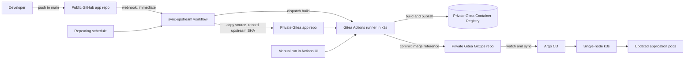

# CI/CD and GitOps deployment flow

Application code is edited on public GitHub, synchronized into private Gitea, built by Gitea Actions, and deployed by Argo CD from the version recorded in the private GitOps repository.

## Sequence

1. A change is pushed to `main` on the public GitHub repository, or an authorized user manually dispatches a build workflow.
2. A GitHub webhook dispatches the sync workflow immediately. A short repeating schedule runs the same workflow as a safety net for a missed delivery.
3. `sync-upstream` copies the GitHub working tree into the private Gitea application repository, excluding `.git` and the `.gitea` workflow directory, and records the upstream commit SHA.
4. The sync dispatches the build workflow explicitly, because Gitea does not trigger workflows for pushes made by Actions itself.
5. Gitea Actions runs `.gitea/workflows/build-images.yaml` on the self-hosted runner.
6. The workflow builds and publishes an image to the private Gitea Container Registry.
7. The workflow updates the image reference in the private GitOps repository.
8. Argo CD detects the Git change and synchronizes Kubernetes manifests.
9. k3s pulls the image and replaces the affected pods.

The Quant Engine, Trading Dashboard and Trade Copier repositories are synchronized and built this way, with push-to-`main`, scheduled and manual triggers. CI and application workloads share one server, so builds compete for host resources.

## Responsibilities

| Component | Role |
|---|---|
| Public GitHub repository | Editing surface for application code |
| GitHub webhook | Dispatches the source sync immediately on push |
| `sync-upstream` workflow | Copies GitHub source into the private Gitea repository and dispatches the build |
| Gitea application repository | Holds the synchronized source and the workflow YAML |
| Gitea Actions runner | Executes sync and build jobs |
| Gitea Container Registry | Stores private images |
| Private GitOps repository | Desired manifests and image versions |
| Argo CD | Reconciles Git state into k3s |

A rollback changes the GitOps image reference to a previously published immutable image version. This public documentation repository is not the GitOps source and is not synchronized into Gitea.
